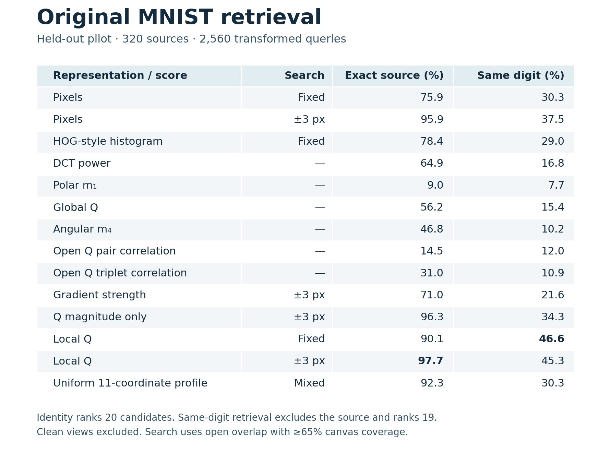

# Similarity observables through Stage 7

The strongest empirical result so far is a matched comparison on original MNIST. With the same finite translation search, the local nematic field improves same-digit retrieval over aligned pixels by **7.77 percentage points** and over its own magnitude-only control by **10.94 points**. The strongest theoretical results specify exactly which distinctions are lost by pooling, by taking a scalar trace, and by truncating the correlation order. Across the program, those gains in resolving power frequently fail to translate into gains in recognition under noise.

## Scope of the audit

The project contains **28 notebooks, numbered 00–27**. I reviewed the saved text, tables and 40 embedded figures, validated each notebook file, and found 102 executed nonempty code cells with zero saved error outputs. Three empty cells have no execution count. I reconciled the MNIST comparison with the saved query outcomes, checked the Stage 7 input hashes against Stage 6, and ran the project tests. All 30 passed. This was an audit of saved experiments and selected recalculations. It was not a fresh rerun of all 28 notebooks or a check of the historical Fashion-MNIST experiments outside this project.

One presentation issue emerged. Notebook 14's secondary illustration compares cuts 0 and 2 of the same ring, whose displayed open pair profiles coincide. Cut 6 provides an actual contrasting example. The all-cut census and its conclusions are unaffected. The saved notebook was left intact for this audit.

## Draft comparison table for a paper

Top-1 accuracy, averaged over **2,560 transformed queries** from 320 original 28×28 MNIST test images in 16 balanced galleries. There are 20 candidates for exact-source retrieval and 19 for same-digit retrieval after removing the original. Each has one relevant candidate. Clean queries are excluded. Development galleries come from the official training split and select aligned local Q for exact-source and fixed local Q for same-digit retrieval. The ±3 pixel searches use the same admissible offsets and require at least 65% jointly observed canvas coverage. Each representation selects its own best offset and can therefore use a different eligible overlap. The HOG-style entry is the project's fixed-grid implementation. [Benchmark notebook](../notebooks/23_MNIST_finite_image_benchmark.ipynb) · [Underlying query outcomes](../results/stage6/decisions.csv.gz) · [MNIST provenance](https://github.com/keras-team/keras/blob/master/keras/src/datasets/mnist.py)

| Method | Exact source (%) | Same digit (%) |
|---|---:|---:|
| Fixed pixels | 75.9 | 30.3 |
| Aligned pixels | 95.9 | 37.5 |
| Fixed HOG-style histogram | 78.4 | 29.0 |
| DCT power | 64.9 | 16.8 |
| Polar m₁ | 9.0 | 7.7 |
| Global Q | 56.2 | 15.4 |
| Angular m₄ | 46.8 | 10.2 |
| Open Q pairs | 14.5 | 12.0 |
| Open Q triplets | 31.0 | 10.9 |
| Aligned gradient strength | 71.0 | 21.6 |
| Aligned Q magnitude | 96.3 | 34.3 |
| Fixed local Q | 90.1 | **46.6** |
| Aligned local Q | **97.7** | 45.3 |
| Uniform 11-coordinate profile | 92.3 | 30.3 |

### What the accuracy gains support

| Comparison | Exact-source Δ in percentage points [95% CI] | Same-digit Δ in percentage points [95% CI] |
|---|---:|---:|
| Aligned Q minus aligned pixels | +1.80 [1.25, 2.38] | **+7.77 [4.41, 11.13]** |
| Aligned Q minus aligned Q magnitude | +1.41 [0.70, 2.11] | **+10.94 [6.76, 14.84]** |
| Aligned Q minus fixed local Q | +7.62 [6.76, 8.48] | −1.33 [−3.79, 1.56] |

These are saved pointwise paired percentile intervals resampling the 16 galleries. A separate 20,000-draw gallery bootstrap reproduced all point estimates and the substantive conclusions. The strongest evidence is the phase ablation. It changes the information carried by the local field while keeping the search policy. The class benefit applies to matching another exemplar of the same digit within these galleries. It is a different task from classifying an image among ten digit labels. [Saved paired differences](../results/stage6/paired_differences.csv)

The **1.80-point exact-source gain comes entirely from the ±18° rotation condition**. Aligned Q recovered 262/320 rotated queries and aligned pixels recovered 216/320. Both recovered every source in the other seven conditions. On rotation alone, fixed local Q recovered 292/320, and fixed pixels recovered 256/320. Translation search helped true translations but reduced exact-source accuracy on rotated queries for both representations. This is evidence about the interaction of a descriptor with its search policy, rather than evidence of rotation invariance. [Condition-level outcomes](../results/stage6/decisions.csv.gz)

The strongest alternative to a performance story is the failure analysis. Fixed and aligned local Q had average within-query rank correlation 0.835 but shared only 28 of 283 exact-source misses made by either. For same-digit retrieval they shared 1,145 of 1,623 misses. In the uniform profile, omitting triplets increased same-digit top-1 from 30.3% to 33.0% (gain 2.7 points, marginal interval 1.1–4.5). That comparison is one of 11 exploratory omissions on this panel. It needs independent confirmation before changing the default profile. Even the improved uniform variant trails local Q alone. [Redundancy and response audit](../THEORY_STAGE7.md)

## What the controlled experiments established

| Stage | Result | What it establishes |
|---|---|---|
| Foundations, 00–07 | The normalized second-order tensor kernel of a single vector is (d cos²θ−1)/(d−1). On nonnegative cosines its ranking is identical to cosine. Cardinal and diagonal distributions collide in mean and Q but have fourth-order squared distance 4. | Higher order adds resolving power to a **collection of directions**. Applying a monotone scalar transform to an existing cosine preserves its ranking. |
| Foundations, 03–07 | Blocked and alternating sequences share all global directional moments and have lag-one correlations 0.875 and −1. Cyclic homometric patterns match to about 10⁻¹⁶ in power and autocorrelation. In the stripe gallery, Q recovers the axis on 100% but scale on 50%, while radial power reverses those rates. Full power recovers both on 100%. | Pooling and frequency reduction each remove identifiable information. The percentages are controlled diagnostics, not natural-image accuracy. |
| Spatial structure, 08–11 | Four tile arrangements share every pooled patch moment. Fixed 8×8 local Q scores 100% clean and 25% under combined transformations. Q correlations, aligned Q and registered pixels all score 100% in that condition. | Position breaks the collision and registration removes the stipulated nuisance. Q ties the matched pixel control. |
| Higher correlations, 12–15 | Two tile fields share the entire cyclic two-state pair table. Their signed third-order correlations at lag pair (1,4) are 2/3 and 0. In a separate vector example, trace loses the sense of rotation and the antisymmetric projection recovers it at the same one-scalar-per-lag budget. | Two distinct losses arise from projecting a statistic and from truncating its order. The latter cannot be repaired by choosing a different projection of the same two-point matrix. |
| Boundaries and noise, 14–15 | All 24 full-length open cuts separate the cyclic pair by open pair signatures. At six visible tiles, 8/24 cuts already collide as exact windows and 15/24 collide under either correlation signature. At noise SD twice signal RMS, triplets score 66.7–85.4% versus 97.9–100% for sign-aware pixel alignment. | A boundary can reveal distinguishing information, while cropping can remove it. Clean resolving power and noise robustness need separate controls. |
| Frozen features, 16–18 | Independent ResNet patch encoding preserves the exact multiset and pair collisions. Under an affine change of the two projected states, the difference of the triplet profiles scales as the cube of the orientation gain. For ridges and bars the measured contrasts are 2.37% and 3.47% of the wave contrast. | The representation can attenuate higher-order evidence before the decision. With noise SD equal to signal RMS, triplet retrieval falls to 56.3% and 53.1% for ridges and bars, versus 100% for matched sign-aware pixels. |
| Context and fusion, 17–21 | A shift moves the late pooled embedding as far as 0.135 versus 0.099 between the clean arrangements. A phase bank raises clean wave retrieval from 50% to 100% while clean ridge and bar retrieval stays around chance. Family-held-out synthetic fusion scores 96.0%, compared with 100% for the development-selected pixel baseline and 79.3% for uniform fusion. | Context can expose structure and also introduce nuisance sensitivity. A ranking objective can select the wrong decision rule for top-1 even with honest family splits. |
| MNIST and audit, 22–27 | Local Q beats the matched pixel and magnitude controls for same-digit retrieval. Gain 0.55 leaves global normalized Q unchanged, moves local Q by 0.089 on average, and moves DCT power by 0.536, as predicted by the squared gain. | The profile makes the measured source of disagreement inspectable. The individual coordinates and their aggregate have different empirical value. |

## What could be novel enough to publish

**The ingredients have substantial precedent.** Double-angle local orientation and structure tensors are established in image analysis. The current local Q uses magnitude rather than squared-magnitude weighting of unit directions, finite support and a damping term. Those choices specify the method to compare. Outer-product pooling of CNN features also has direct prior work. [Bigün and Granlund, optimal orientation detection](https://www2.hh.se/staff/josef/public/publications/bigun86trlondon.pdf) · [Brox et al., nonlinear structure tensors](https://lmbweb.informatik.uni-freiburg.de/Publications/2006/Bro06c/) · [Lin, RoyChowdhury and Maji, bilinear CNNs](https://www.cv-foundation.org/openaccess/content_iccv_2015/html/Lin_Bilinear_CNN_Models_ICCV_2015_paper.html)

**Equal power with different structure is a known inverse problem.** Homometry and phase-sensitive bispectral invariants predate this project. Joint statistics across location, orientation and scale also have a long history in texture modeling. The notebook examples turn these ideas into exact controls for a similarity and retrieval pipeline. [Grimm and Baake, homometric point sets](https://arxiv.org/abs/0808.0094) · [Kakarala, bispectral invariants](https://arxiv.org/abs/0902.0196) · [Portilla and Simoncelli, joint texture statistics](https://www.cns.nyu.edu/pub/lcv/portilla99-reprint.pdf)

**The candidate contribution is the experiment and its explanatory framework.** The most coherent story is a profile whose coordinates have explicit invariances and known collisions, tested through the same interventions at the representation, observable and decision levels. The cube-law control connects an encoder's measured loss of separation to a higher-order response. The matched MNIST phase ablation shows where local angular information matters in a standard dataset. The negative fusion results prevent the contribution from resting on a claim that more coordinates necessarily yield a better scalar score. This is a promising research contribution, and a targeted literature review is still needed to establish priority for the exact combination and protocol.

## Before turning the draft into a benchmark claim

- Freeze the primary endpoint and decision on development data. Keep same-source and same-class retrieval as separate columns. Give each proposed change and comparator the same source IDs, galleries, perturbations, support rules, and opportunity to register.
- Fill the missing matched rows with conventional normalized structure-tensor descriptors, a standard HOG implementation with the allowed search, normalized cross-correlation, and a specified frozen embedding baseline. A result from a different dataset or gallery cannot fill a row. Label learned models and training data explicitly. [Dalal and Triggs, standard HOG](https://sites.cc.gatech.edu/classes/AY2016/cs4476_fall/proj5/papers/dalal_triggs_cvpr_2005.pdf)
- Replicate on an untouched panel with more independent galleries, more same-class exemplars, and harder distractors. The current exact-source ceiling makes the rotation condition unusually influential. Report per-condition outcomes and paired intervals in addition to the aggregate. Report runtime when comparing search strategies.
- Treat the Stage 7 triplet omission and related ablations as hypotheses. Validate any resulting selection independently. An eventual figure should carry a protocol caption and its paired comparison intervals beside the top-1 table.

## Notebook-by-notebook audit index

| Notebook | Main saved result checked |
|---|---|
| [00](../notebooks/00_Research_contract.ipynb) | The motif panel holds many first-order properties fixed while changing orientation and structure. |
| [01](../notebooks/01_From_cosine_to_angular_order.ipynb) | Tensor and angular kernel contractions agree to floating-point precision. |
| [02](../notebooks/02_Moment_collisions.ipynb) | Cardinal and diagonal distributions collide at orders 1 and 2, with squared distance 4 at order 4. |
| [03](../notebooks/03_Position_and_sequence.ipynb) | Equal direction multisets give opposite behavior at lag one. |
| [04](../notebooks/04_Homometry_and_higher_correlations.ipynb) | Power and autocorrelation coincide, while selected third-order statistics differ. |
| [05](../notebooks/05_Similarity_profiles.ipynb) | Rotation, shifts, rearrangement and the Nyquist checkerboard expose representation-specific invariances. |
| [06](../notebooks/06_Uncertainty_and_null_models.ipynb) | Simulations track the isotropic finite-sample baseline (1−1/d)/N. Repeated directions leave Q unchanged. |
| [07](../notebooks/07_Controlled_retrieval_and_research_program.ipynb) | Q and radial power recover complementary stripe labels. |
| [08](../notebooks/08_Representations_and_information.ipynb) | Equal inventories defeat pooled patch statistics, while local Q differs. Full orthonormal DCT preserves patch moment distances. |
| [09](../notebooks/09_Spatial_scale_and_registration.ipynb) | Changing grid scale alters translation sensitivity. A whole-tile shift restores the patch multiset. |
| [10](../notebooks/10_Position_orientation_correlations.ipynb) | Translation shifts the local Q field while preserving its periodic correlation. |
| [11](../notebooks/11_Spatial_discrimination_and_robustness.ipynb) | Registered Q, Q correlations and registered pixels tie at 100% on four designed layouts. |
| [12](../notebooks/12_Homometric_orientation_fields.ipynb) | Two-point matrix equality survives fixed state encoding, with an exact third-order witness. |
| [13](../notebooks/13_Vector_correlations_and_trace.ipynb) | A signed off-diagonal projection separates the two rotation senses. |
| [14](../notebooks/14_Open_boundaries_and_cropping.ipynb) | The exhaustive cut census separates boundary information from crop ambiguity. |
| [15](../notebooks/15_Motif_transfer_and_noise.ipynb) | Noise reveals the advantage of sign-aware pixel alignment over the triplet profile on these motifs. |
| [16](../notebooks/16_Frozen_patch_geometry.ipynb) | Frozen independent encoding preserves collisions. Transferred orientation gains predict cubic triplet attenuation. |
| [17](../notebooks/17_Context_and_whole_image.ipynb) | Identical central tiles differ in late contextual features. Shifts can exceed the unshifted class distance. |
| [18](../notebooks/18_Frozen_encoder_retrieval.ipynb) | A phase bank helps clean waves, while local triplet retrieval loses robustness on transferred noisy motifs. |
| [19](../notebooks/19_Pair_profiles_and_family_split.ipynb) | Image-only S(A,B) returns six symmetric agreements with a visible contribution for each. |
| [20](../notebooks/20_Fit_and_heldout_evaluation.ipynb) | Raw and rescaled fits choose aligned orientation, while the development-selected pixel baseline wins held-out top-1. |
| [21](../notebooks/21_Explain_decisions_and_image_bridge.ipynb) | Exact attribution explains why the fitted winner differed from the correct candidate. |
| [22](../notebooks/22_Open_image_boundaries.ipynb) | Open overlap removes wraparound and distinguishes missing support from observed black pixels. |
| [23](../notebooks/23_MNIST_finite_image_benchmark.ipynb) | The matched local-Q and phase-ablation gains hold on the saved MNIST galleries. |
| [24](../notebooks/24_MNIST_profile_scorecard.ipynb) | Local Q favors the correct 7 while fourth order and DCT power drive the uniform score toward a 6. |
| [25](../notebooks/25_MNIST_component_redundancy.ipynb) | Rank correlation and shared mistakes give different answers about redundancy. |
| [26](../notebooks/26_MNIST_intervention_response.ipynb) | Known changes expose coordinate sensitivity, with exact gain, sign and translation controls. |
| [27](../notebooks/27_MNIST_profile_ablation.ipynb) | Removing triplets or fourth order improves this uniform profile on the pilot, pending independent validation. |
